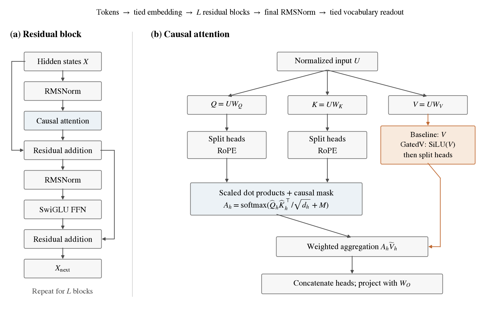

# GatedV: Self-Gated Values for Transformer Language Models

GatedV applies SiLU to projected values before attention aggregation:

$$
\widetilde V = V \odot \sigma(V), \qquad
Y = \mathrm{softmax}(QK^\top/\sqrt{d_h}+M)\widetilde V W_O.
$$

It preserves the query/key projection structure, attention-weighting rule, value width and
trainable parameter count of the baseline Transformer. This repository contains
the reference implementation, experiment recipes, recorded numerical results,
and the [manuscript](paper/main.tex) by **Li-Ming Yu**
([ORCID](https://orcid.org/0000-0001-7552-8895)). Value-side nonlinearities have
prior art; the study examines this intervention in a controlled common backbone.



## Results

The completed confirmation experiments use paired seeds, matching parameter
counts and equal training-token budgets. PPL below is the arithmetic mean across
seeds, with sample standard deviation.

| Parameters | Paired seeds | Baseline held-out PPL | GatedV held-out PPL | Reduction |
|---|---:|---:|---:|---:|
| 2,328,192 | 5 | 59.1182 ± 0.5298 | 57.9157 ± 0.7816 | 2.03% |
| 26,158,464 | 3 | 21.3836 ± 0.1658 | 20.5999 ± 0.0184 | 3.66% |

All pairs improve under these recipes. The larger experiment selected each arm's
learning rate from `{6e-4, 1.2e-3, 2.4e-3}`; both selected the lower boundary.
These results therefore describe that search and its confirmation recipes.
The short shared-host DGX Spark benchmark measured approximately **0.70%** higher
full-context forward latency. Timings were synchronized elapsed measurements;
they were not normalized for temperature, frequency or power, and do not measure
autoregressive decoding speed.

### GLU and lower-learning-rate follow-up

**Snapshot: 15 October 2026, 08:40 Beijing time.** Five of the planned sixteen
trajectories have completed. Each uses one selection seed, 327,680 updates and
671,088,640 target exposures. The table contains final **development** PPL,
not held-out confirmation results.

| Model | Parameters | Peak LR 6e-4 | Peak LR 3e-4 |
|---|---:|---:|---:|
| Baseline | 26,158,464 | 21.5583 | 20.5583 |
| GatedV | 26,158,464 | 21.0047 | In progress |
| GLU, full width | 27,927,936 | 21.1972 | Pending |
| GLU, reduced width | 26,186,112 | 21.5221 | Pending |

The complete plan tests `{6e-4, 3e-4, 1e-4, 1e-5}` for every arm. Reduced-width
GLU uses 258 value channels to retain six heads and is approximately parameter
matched. At 6e-4, GatedV has the lowest development PPL. Lowering the baseline LR
to 3e-4 improves its PPL by 4.64%; per-arm LR selection remains incomplete.
This follow-up does not establish a ranking after tuning or a new held-out result.
The manuscript is retained as its existing draft and does not yet incorporate
this follow-up. See the [follow-up recipes](experiments/glu_attention/README.md)
and [result evidence](docs/results.md).

## Reproduce the main experiments

Use Python 3.10+ on Linux or macOS. The quick check runs on CPU; the full
recipes default to CUDA and require a compatible PyTorch installation. From a
fresh checkout:

```sh
git clone https://github.com/yuliming1996/GatedV.git
cd GatedV
python -m venv .venv
source .venv/bin/activate
python -m pip install -r requirements-reproduce.txt
python -B tools/reproduce.py --study smoke
```

The smoke command creates a tiny synthetic corpus, trains both arms and evaluates
them. It checks that the pipeline works; its scores are not scientific evidence
for GatedV or a reproduction of the paper's improvements.

To reproduce the **small-model confirmation**, run:

```sh
python -B tools/reproduce.py --study small --download
```

This command verifies the bundled tokenizer and frozen document selections,
downloads and verifies the pinned public source shards, reconstructs the original
data, trains all ten full-budget trajectories (five paired seeds), evaluates the
completed cohort on the original holdout and computes the paired statistics.
It uses repository-relative defaults and does not need the author's workspace.
The medium confirmation uses six full-budget trajectories (three pairs):

```sh
python -B tools/reproduce.py --study medium --download
```

These are substantial training jobs, not quick examples. Small data preparation
needs about 2.69 GB of raw shards plus 0.10 GB of prepared files; medium needs
about 6.46 GB plus 1.06 GB. Allow additional disk space for dependencies and
checkpoints. Downloads require `curl`, network access and upstream availability.
The commands reproduce the **reported confirmation recipes at their selected
learning rates**; they do not repeat learning-rate selection or the unfinished
GLU follow-up. Data bytes are checked against historical hashes. Results can
still vary with software and hardware, and reproducing the reported gains is an
experimental outcome rather than a guarantee.

Use `--dry-run` to inspect the full plan without downloading or training. To
continue an interrupted run, repeat the same command with `--resume`; identity
checks reject incompatible code, data, settings or environments. Existing outputs
are not silently overwritten. See [usage](docs/usage.md) for paths, recovery,
individual training commands and timing, and the [data preparation guide](reproduction/README.md)
for the frozen dataset reconstruction procedure.

Historical source identifiers in result JSON files describe provenance, not
files required to run the code. The original [tokenizer](tokenizer/README.md) and
accepted-row lists are bundled; raw corpora and checkpoints are reconstructed or
created locally. The data tool replays accepted rows rather than rerunning the
historical filtering audit. Substituting documents or retraining the tokenizer
constitutes a new experiment.

## Verify results and build figures

```sh
# Standard-library check of the packaged file inventory.
python tools/verify_release.py

# Recalculate retained results; requires NumPy, no model training or GPU.
python results/verify_results.py

# Rebuild the manuscript figures from the recorded development evaluations.
python -m pip install -r requirements-figures.txt
python paper/make_paper_figures.py
```

The evidence includes negative outcomes and exploratory experiments in addition
to the confirmation results. Verification checks the retained numerical files;
it does not rerun the original training. The medium per-document arrays contain
losses and indices, not token IDs or source text. See [results](docs/results.md)
for uncertainty estimates and evidence scope, and [paper instructions](paper/README.md)
for LaTeX compilation.

## Repository contents

| Directory | Contents |
|---|---|
| `code/` | Model, training, evaluation, analysis and timing implementation |
| `tools/` | One-command reproduction, data preparation and release verification |
| `reproduction/` | Frozen accepted rows, pinned source URLs and data preparation guide |
| `tests/` | Bounded checks for the public reproduction tools |
| `tokenizer/` | Original 8,192-token BPE, provenance and loading instructions |
| `configs/` | Small/medium recipes and explicit evaluation cohorts |
| `experiments/glu_attention/` | Four-arm implementation and sixteen LR recipes |
| `results/` | Numerical evidence, provenance and statistical verification |
| `paper/` | Current LaTeX draft, bibliography and Python-generated figures |
| `docs/` | Usage, data format, evidence and release notes |

## Citation and license

The public repository is [yuliming1996/GatedV](https://github.com/yuliming1996/GatedV).
Citation metadata is in [CITATION.cff](CITATION.cff). No arXiv identifier or
publication DOI has been assigned in this repository snapshot.

Code is distributed under the [MIT license](LICENSE).
[Related work and implementation provenance](THIRD_PARTY_NOTICES.md) identify
the external references. Upstream datasets and dependencies retain their own
terms.

See [release notes](docs/release_notes.md) for validation scope and snapshot details.
