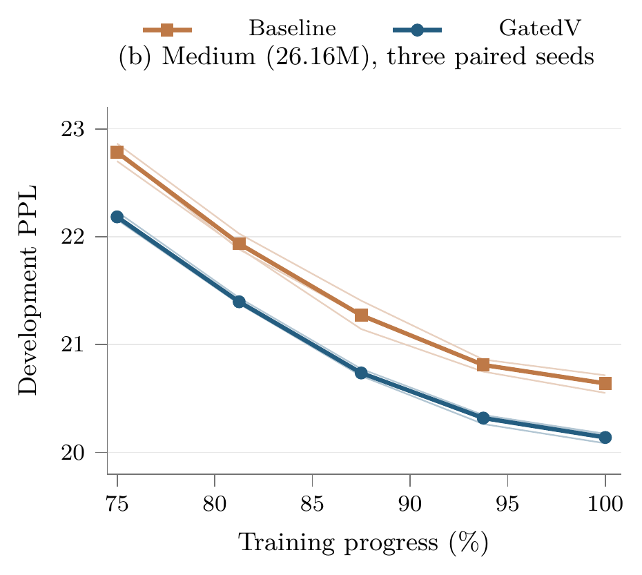

# GatedV: Self-Gated Values for Transformer Language Models

We propose **GatedV**, a simple attention variant that introduces value self-gating
without adding trainable parameters. We apply SiLU to the projected values before
attention aggregation, keeping the standard query-key attention mechanism:

$$
\widetilde V = \mathrm{SiLU}(V) = V \odot \sigma(V).
$$

## Results

We compared GatedV with standard decoder-only Transformers using matched
parameter counts and training-token budgets. Mean held-out perplexity improved
at both model sizes:

| Parameters | Paired seeds | Baseline PPL | GatedV PPL | PPL reduction |
|---|---:|---:|---:|---:|
| 2.33M | 5 | 59.12 | 57.92 | 2.03% |
| 26.16M | 3 | 20.23 | 19.75 | 2.40% |

Every seed pair improved. The medium-model results use the development-selected
peak learning rate of 0.0003. The original 0.0006 results are retained in the
paper appendix. A short DGX Spark benchmark using the original medium-model
checkpoints measured about 0.7% higher full-context forward latency.
The details are presented in our [paper](paper/main.tex).

<p align="center">
  
</p>

*Figure 3b. Development perplexity over the final quarter of training. Thin lines show individual runs and thick lines show the mean across three seeds for each model.*

## Usage

To try GatedV in an existing attention layer, apply SiLU after the value projection
and before aggregation:

```python
v = torch.nn.functional.silu(v)
```

To reproduce the small-model comparison, use Python 3.10+, Linux or macOS,
`curl`, and a CUDA-compatible PyTorch installation:

```sh
git clone https://github.com/yuliming1996/GatedV.git
cd GatedV
python -m venv .venv
source .venv/bin/activate
python -m pip install -r requirements-reproduce.txt
python -B tools/reproduce.py --study small --download
```

This downloads the data, trains the paired models, and evaluates them. Replace
`small` with `medium` for the larger model; add `--resume` to continue an
interrupted run. The current `medium` recipe reproduces the original peak-LR
0.0006 confirmation; the revised paper's main medium-model result uses 0.0003.
Verification commands are in [verification/README.md](verification/README.md).

## Repository structure

```text
code/                         Model, training and evaluation
configs/                      Experiment settings
tools/                        Data preparation and reproduction
reproduction/, tokenizer/     Data recipes and tokenizer
results/                      Results and learning curves
experiments/                  GLU controls
paper/                        Manuscript and figures
verification/                 Verification instructions
```

## Additional comparisons

| Experiment | Status |
|---|---|
| GLU comparison and lower learning rates | Completed; reported in the paper |
| Tanh self-gating ablation | Completed; reported in the paper |

We encourage researchers and engineers to try GatedV in their own projects:
it is inexpensive and easy to implement. If you use GatedV in your work, please
cite [GatedV: Self-Gated Values for Transformer Language Models](CITATION.cff).

[MIT license](LICENSE) · [Third-party notices](THIRD_PARTY_NOTICES.md)
